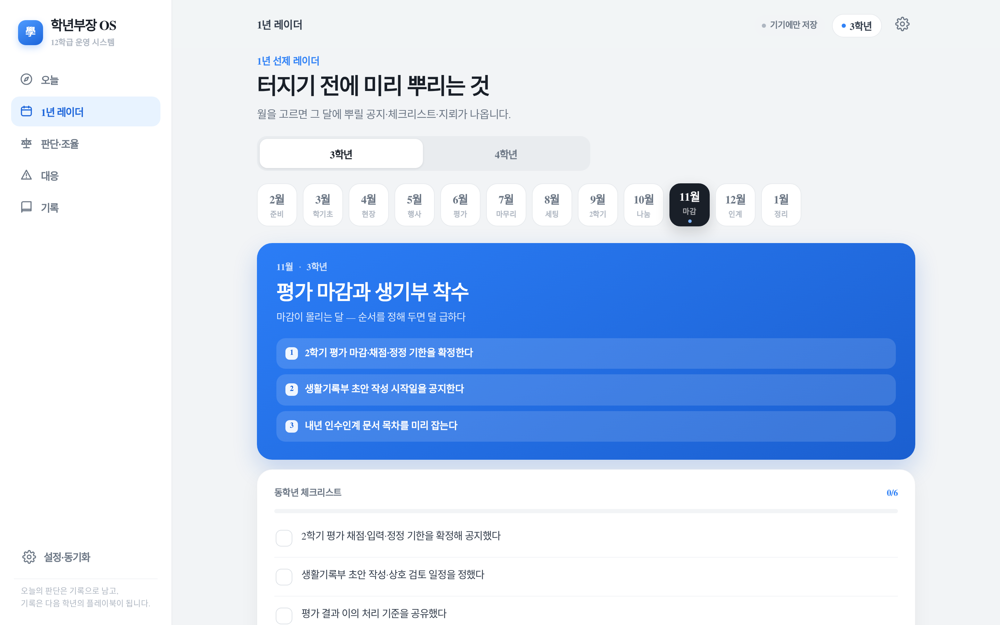
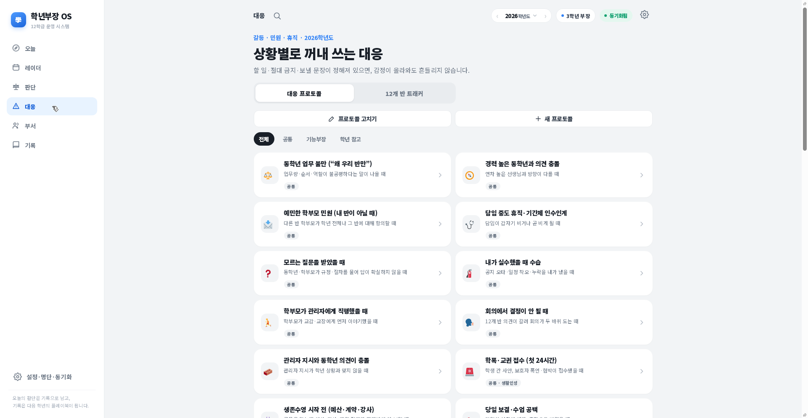

# 학년부장 OS

12학급 규모 초등학교의 **학년부장 운영 시스템**입니다.
처음 학년부장을 맡아도 흔들리지 않도록, 판단·조율·대응·기록을 한 곳에 모았습니다.

> 자질구레한 일은 부장이 초안으로 치워 동학년이 자기 반에만 집중하게 하고,
> 큰 사안은 조율·교통정리하고, 민원·휴직 같은 돌발 변수는 보고선 기준으로 끊는다.

- **웹 앱(PWA)**: 폰 홈 화면에 설치해 쓰고, 인터넷이 없어도 열립니다.
- **기록은 비공개**: 트래커·회고는 내 구글 계정의 비공개 시트에만 저장됩니다.
- **공개 코드에 개인정보 0건**: 학교명·실명·시트 주소·배포 주소를 넣지 않았습니다.


| 1년 레이더 | 대응 프로토콜 |
|---|---|
|  |  |

## 5가지 모듈

| | 모듈 | 하는 일 |
|---|---|---|
| 🧭 | **오늘 · 3초 판단** | 질문·민원이 왔을 때 3개 체크로 `초안 즉시 제시` / `즉답 금지` / `즉시 보고`를 가르고, 그대로 보낼 문장을 만들어 줍니다. |
| 📅 | **1년 선제 레이더** | 2월 준비 → 3월 학기초 → … → 1월 정리. 월별 **미리 뿌릴 공지 초안 · 동학년 체크리스트 · 놓치기 쉬운 지뢰 · 부장이 직접 챙길 일**, 3학년/4학년 포인트. |
| ⚖️ | **판단 · 조율** | 단순 일(초안형)과 협조 일(의견 수렴형) 판별, 12학급 공지 원칙, 보고 3줄 양식, **보고선 기준표**(지금 바로 / 당일 서면 / 동학년 선 정리). |
| 🚨 | **대응** | 10가지 상황(업무 불만, 경력 교사 갈등, 예민한 민원, 담임 휴직·인수인계, 모를 때, 실수 수습, 관리자 직행, 회의 교착, 지시 충돌, 학폭·교권)별 **할 일 · 절대 금지 · 중립 멘트(복사) · 기록 기준** + 12개 반 트래커. |
| 📝 | **기록** | 내가 내린 판단·결과·다음에 바꿀 점을 쌓아 나만의 학년부장 플레이북으로 만듭니다. |

## 시작하기

1. **앱 열기** — GitHub Pages 주소를 폰 브라우저에서 열고 `홈 화면에 추가`.
2. **동기화 연결(선택, 3분)** — [SETUP.md](SETUP.md)의 세 줄.
   연결하지 않아도 이 기기에 저장되며 바로 쓸 수 있습니다.

## 저장 구조

- **기기**: `localStorage` (오프라인에서도 동작)
- **연결 시**: 내 구글 드라이브의 비공개 시트 `[비공개] 학년부장 운영 시스템`
  - `docs` 탭: `key | rev | updated_at | chunks | data` — **문서 단위 JSON 통저장**
    (구글 시트 셀 한도가 5만 자라서, 넘으면 45,000자 단위로 옆 칸에 이어 저장합니다)
  - `prev` 탭: 저장 직전 내용 한 벌(한 단계 되돌리기), `log` 탭: 저장 이력(최근 200줄)
- **충돌 처리**: `rev`가 다르면 서버가 `conflict`로 돌려주고, 앱이 **항목별 `updatedAt` 기준으로 병합**한 뒤 다시 저장합니다.
- **필드를 늘려도 `Code.gs`를 다시 배포할 필요가 없습니다.** 앱이 보내는 JSON을 그대로 저장하는 범용 구조이기 때문입니다.

## 파일

```
index.html            화면 껍데기
styles.css            디자인 시스템 (Toss 스타일)
data.js               1년 레이더·프로토콜·보고선 등 콘텐츠
app.js                화면·상태·동기화
manifest.webmanifest  PWA 설정
sw.js                 서비스 워커 (앱 껍데기만 캐시)
apps-script/Code.gs   비공개 시트 백엔드 (범용 JSON 저장)
tools/                아이콘 생성·검증 스크립트
```

## 검증

```bash
python3 tools/verify.py      # PC 1440×900 / 모바일 390×844 전 탭·상호작용·콘솔 오류·가로 넘침
python3 tools/sync_test.py   # 가짜 백엔드로 연결·저장·다중 기기 병합 검증
```

두 스크립트 모두 통과 기준: 콘솔 오류 0, 페이지 오류 0, 모바일 가로 넘침 0.

## 개인정보 원칙

이 저장소에는 학교명, 사용자 실명, 교사·학생 이름, 시트 주소, Apps Script `/exec` 주소가 **없습니다**.
실제 기록(민원·휴직·상담)은 비공개 시트에만 남습니다. 앱 화면의 예시도 “1반 학부모 A”처럼 일반화되어 있습니다.

## 고칠 때 (유지보수 메모)

- 화면 문구만 바꾸면 `data.js`만 고치면 됩니다. (레이더·프로토콜·보고선은 모두 데이터)
- 파일을 고쳤으면 **`sw.js`의 `CACHE` 이름을 올려** 주세요(예: `grade-head-os-v1.0.1`). 그래야 폰에 캐시된 옛 화면이 바뀝니다.
- 저장 필드를 늘려도 `apps-script/Code.gs`는 다시 배포하지 않아도 됩니다. 앱이 보내는 JSON을 그대로 저장하기 때문입니다.
- `코드`를 고치면 `APP_VERSION`(app.js)과 `BACKEND_VERSION`(Code.gs)을 함께 올려 두면 나중에 원인 찾기가 쉽습니다.

## 참고

- 이 앱은 학교·교육청의 규정과 공문을 대체하지 않습니다. 판단의 기준을 잊지 않기 위한 도구입니다.
- 화면의 ○ 표시는 학교 일정·양식에 맞게 채워 쓰는 자리입니다.

MIT License
