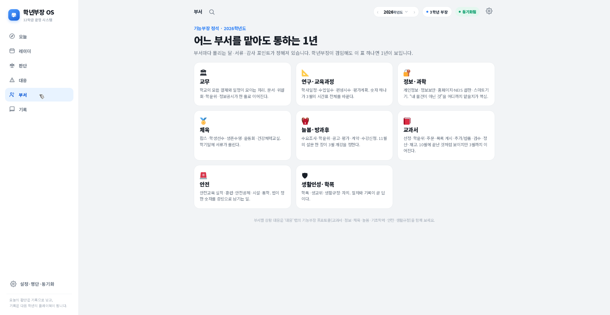
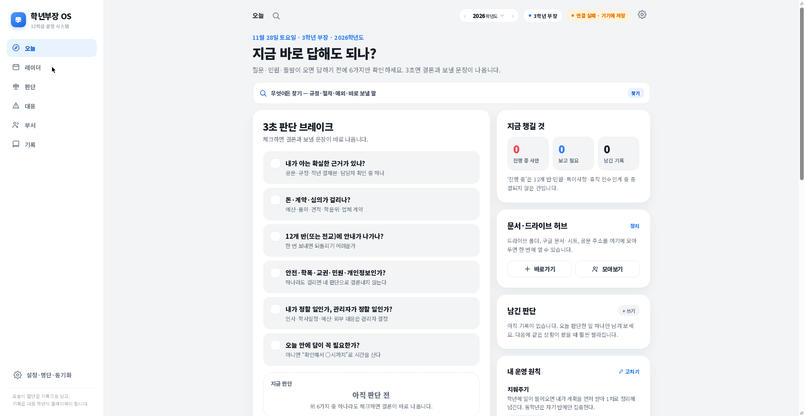

# 학년부장 OS

12학급 규모 초등학교의 **학년부장 운영 시스템**입니다.
처음 학년부장을 맡아도 흔들리지 않도록, 판단·조율·대응·기록을 한 곳에 모았습니다.

> 자질구레한 일은 부장이 초안으로 치워 동학년이 자기 반에만 집중하게 하고,
> 큰 사안은 조율·교통정리하고, 민원·휴직 같은 돌발 변수는 보고선 기준으로 끊는다.

- **해가 갈수록 자라는 구조**: 학년도를 넘겨도 내가 고친 레이더·지뢰·공지 초안이 이어집니다.
- **열린 편집**: 레이더·운영 원칙·보고선·대응 프로토콜·기록에 항목과 링크를 직접 추가·수정·삭제합니다.
- **하나의 컨트롤 타워**: 구글 드라이브 폴더·문서·시트·공문 링크를 허브에 모아 한 번에 엽니다.
- **웹 앱(PWA)**: 폰 홈 화면에 설치해 쓰고, 인터넷이 없어도 열립니다.
- **기록은 비공개**: 트래커·회고·명단은 내 구글 계정의 비공개 시트와 이 기기에만 저장됩니다.
- **공개 코드에 개인정보 0건**: 학교명·실명·시트 주소·배포 주소를 넣지 않았습니다.
- **v4 콘텐츠 축**: 전국 학년부장·교무·생활인성·학폭·안전·연구·체육·늘봄·정보·교과서·기초학력·영어·진로 방 20개, 32만여 건(2026년 3~11월)과 실무 아카이브 13편을 다시 읽고 “무엇을 언제, 누구 손으로, 어떤 서류로 끝내는가”를 기준으로 전부 다시 썼습니다. 특정 학년 업무(생존수영·졸업·수학여행)는 `학년 참고` 태그로만 두어, 어느 학년·어느 기능부장을 맡아도 공통으로 쓸 수 있게 했습니다.



| 1년 레이더 | 대응 프로토콜 |
|---|---|
|  |  |

| 홈 · 3초 판단 |
|---|
|  |

## 모듈

| | 모듈 | 하는 일 |
|---|---|---|
| 🧭 | **오늘 · 3초 판단** | 질문·민원이 왔을 때 6개 체크(근거·돈/계약·12개 반 파급·안전/학폭/교권·결정권·시간)로 `초안 즉시 제시` / `즉답 금지` / `행정실·교무실 경유` / `관리자 결정 먼저` / `즉시 보고`를 가르고, 그대로 보낼 문장과 실제 실패 사례를 함께 보여 줍니다. 맨 위 **찾기**는 규정·절차·예외·보낼 말을 한 번에 검색합니다. |
| 📅 | **1년 선제 레이더** | 2월 준비 → 3월 학기초 → … → 1월 정리. 월별 **판단 방식(초안 먼저/의견 조율) · 단톡방 실제 고민 · 공지 초안 · 동학년 체크리스트 · 지뢰 · 보고·행정실 타이밍 · 학년 포인트 · 내 메모 · 링크**를 앱에서 바로 고치고 더하고 지웁니다. |
| ⚖️ | **판단 · 조율** | ① 관리자 보고 기준(즉시/당일/사후) ② 결정권(내가·학년이·관리자가) ③ 결재·품의·학운위·행정실 **순서표**(업무별 순서·담당·함정·기한) ④ 회의·수합·공지 **효율화 정석**. 보고 3줄과 공지·회의 양식 포함. |
| 🚨 | **대응** | 40가지 대응 프로토콜 — `공통` / `기능부장` / `학년 참고` 로 걸러 봅니다(수정·추가·메모·링크) + **12개 반 트래커**. 반을 고르면 비공개 시트 `명단`의 학생·교사가 칩으로 떠서 탭 한 번에 대상자가 들어갑니다. |
| 🏛 | **부서** | 기능부장 8개 부서(교무·연구·정보·체육·늘봄·교과서·안전·생활인성)의 1년 흐름·서류·감사 포인트·베테랑 팁. |
| 📝 | **기록** | 상황·판단·결과·다음엔 + 태그 + 링크. 학년도별 누적, **전체 학년도 검색**. |

## 학년도(연도) 누적

- 상단 배지 **`‹ 2026학년도 ▾ ›`** 로 어느 탭에서든 연도를 넘기고 지난 학년도를 다시 열어 봅니다.
- **`＋ 다음 학년도 시작`** 에서 *전년도 레이더(내가 고친 체크리스트·지뢰·공지 초안) 복사* 를 고르면 노하우가 그대로 이어집니다.
- 체크리스트 완료 표시·사안·기록은 학년도마다 따로 쌓입니다(새 학년도는 빈 상태로 시작).
- **학년은 1~6학년 전부** 고를 수 있고, **역할·직책 이름**(예: `3학년 부장`, `기능부장`, `정보부장`)을 직접 적어 배지에 답니다.

## 문서·링크·내보내기

- **링크**: 레이더 월 카드, 대응 프로토콜, 사안 트래커, 기록, 운영 원칙, 보고선 항목마다 `🔗 링크 추가`(라벨 + URL). `http(s)`만 저장하고 바로 열립니다.
- **허브**: 홈 카드에서 드라이브·문서·시트·기타로 분류해 고정하고, 레이더·프로토콜·사안·기록에 단 링크까지 한 화면에 모아 봅니다.
- **내보내기(설정 또는 기록·레이더에서)**
  1. **구글 문서용 복사** — 서식 있는 HTML + 텍스트가 함께 복사되어 Docs에서 `Ctrl+V` 하면 제목·목록·표로 들어갑니다.
  2. **CSV** — `레이더_정리` · `사안_트래커` · `판단_기록` 3종, UTF-8 BOM 포함(엑셀·구글시트 한글 안 깨짐).
  3. **JSON 백업** — 전체 학년도.

## 시작하기

1. **앱 열기** — GitHub Pages 주소를 폰 브라우저에서 열고 `홈 화면에 추가`.
2. **동기화 연결(선택, 3분)** — [SETUP.md](SETUP.md)의 세 줄.
   연결하지 않아도 이 기기에 저장되며 바로 쓸 수 있습니다(명단은 직접 붙여넣기 가능).

## 저장 구조

- **기기**: `localStorage` (오프라인에서도 동작)
- **연결 시**: 내 구글 드라이브의 비공개 시트 `[비공개] 학년부장 운영 시스템`
  - `docs` 탭: `key | rev | updated_at | chunks | data` — 학년도 전체가 든 문서 단위 JSON
    (구글 시트 셀 한도가 5만 자라서, 넘으면 45,000자 단위로 옆 칸에 이어 저장합니다)
  - `prev` 탭: 저장 직전 내용 한 벌(한 단계 되돌리기), `log` 탭: 저장 이력(최근 200줄)
  - `명단` 탭: `구분 | 반 | 번호 | 이름 | 비고` — 앱이 읽어 트래커 대상자 칩으로 씁니다
  - `레이더_정리` · `사안_트래커` · `판단_기록` 탭: **사람이 바로 열어보는 평면 표**
    (앱이 저장할 때마다 같은 내용으로 다시 채웁니다 — 필터·복사·인쇄용)
- **충돌 처리**: `rev`가 다르면 서버가 `conflict`로 돌려주고, 앱이 **항목별 `updatedAt` 기준으로 병합**한 뒤 다시 저장합니다.
- **필드를 늘려도 `Code.gs`를 다시 배포할 필요가 없습니다.** 앱이 보내는 JSON과 표를 그대로 저장하는 범용 구조입니다.

## 파일

```
index.html            화면 껍데기
styles.css            디자인 시스템
data.js               1년 레이더·프로토콜·보고선 기본값(사용자가 고치면 그 사본이 저장됨)
app.js                화면·상태·학년도·편집·링크·동기화·내보내기
manifest.webmanifest  PWA 설정
sw.js                 서비스 워커 (앱 껍데기만 캐시)
apps-script/Code.gs   비공개 시트 백엔드 (JSON 저장 + 사람용 표 미러 + 명단 읽기)
tools/                검증 스크립트
```

## 검증

```bash
python3 tools/verify.py      # PC 1440×900 / 모바일 390×844 — 전 탭·편집·학년도·명단·링크·허브·CSV/Docs·콘솔 오류·넘침
python3 tools/sync_test.py   # 가짜 백엔드 — 연결·저장·다중 기기 병합·명단 자동 반영·미러 표 전송
python3 tools/codegs_test.py # Code.gs를 브라우저에서 실행 — 저장/충돌/청크/prev/명단/미러 표
python3 tools/pages_test.py  # /grade-head-os/ 하위 경로·매니페스트·오프라인 재방문
```

모두 통과 기준: 콘솔 오류 0, 페이지 오류 0, 모바일 가로 넘침 0.

## 개인정보 원칙

이 저장소에는 학교명, 사용자 실명, 교사·학생 이름, 시트 주소, Apps Script `/exec` 주소가 **없습니다**.
실제 기록(민원·휴직·상담)과 명단은 비공개 시트에만 남습니다. 앱 화면의 예시도 “1반 학부모 A”처럼 일반화되어 있습니다.

## 고칠 때 (유지보수 메모)

- 화면 문구만 바꾸면 `data.js`만 고치면 됩니다. 단, 사용자가 앱에서 고친 달은 저장된 사본이 우선합니다.
- 파일을 고쳤으면 **`sw.js`의 `CACHE` 이름을 올려** 주세요(예: `grade-head-os-v2.0.1`). 그래야 폰에 캐시된 옛 화면이 바뀝니다.
- `Code.gs`를 고쳤으면 **배포 → 새 버전**으로 다시 배포해야 시트 쪽이 바뀝니다.
- `APP_VERSION`(app.js)과 `BACKEND_VERSION`(Code.gs)을 함께 올려 두면 원인 찾기가 쉽습니다.

## 참고

- 이 앱은 학교·교육청의 규정과 공문을 대체하지 않습니다. 판단의 기준을 잊지 않기 위한 도구입니다.
- 화면의 ○ 표시는 학교 일정·양식에 맞게 채워 쓰는 자리입니다.

MIT License
